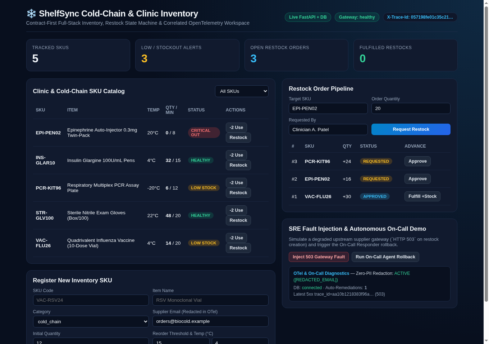
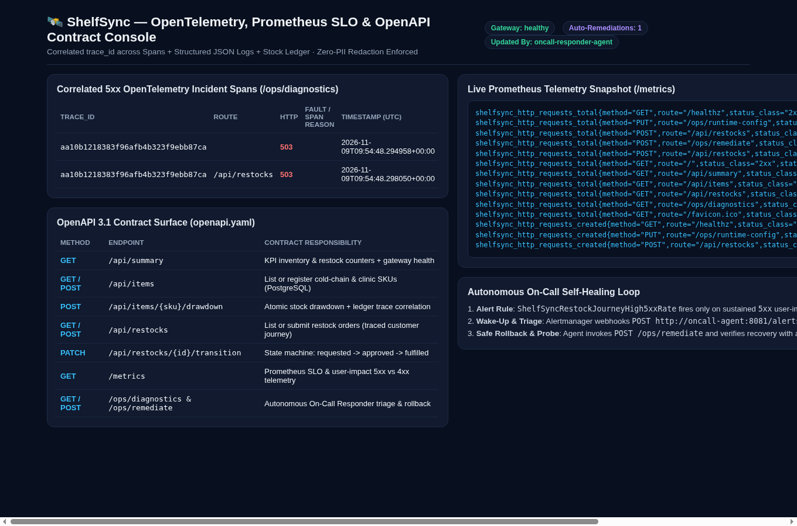
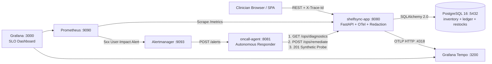

# ❄️ ShelfSync — Cold-Chain & Clinic Inventory Platform with Autonomous On-Call Remediation

[](https://github.com/OmachokoYakubu/ai-dev-tools-zoomcamp/actions/workflows/project2-ci-cd.yml)
[](https://github.com/OmachokoYakubu/ai-dev-tools-zoomcamp/actions/workflows/project2-promote-prod.yml)

**Live Interactive Preview (`dev` environment):** [https://omachokoyakubu.github.io/ai-dev-tools-zoomcamp/](https://omachokoyakubu.github.io/ai-dev-tools-zoomcamp/)  
**Container Images (GHCR):** `ghcr.io/omachokoyakubu/shelfsync-app:dev` · `ghcr.io/omachokoyakubu/shelfsync-app:prod`  
**Public Task Tracker:** [GitHub Issues `#1`–`#5`](https://github.com/OmachokoYakubu/ai-dev-tools-zoomcamp/issues?q=is%3Aissue+ShelfSync)

---

## 1. Problem Statement & Core User Journey

Outpatient clinics, vaccination centers, and diagnostic labs lose thousands of dollars—and risk patient care delays—when temperature-sensitive biologics (`cold_chain` vaccines, insulin pens, `-20°C` PCR reagents) silently run out or get stuck in untracked spreadsheet restock requests.

**ShelfSync** is an AI-engineered, contract-first full-stack inventory, stock-drawdown ledger, and autonomous SRE operations platform that solves this end to end:

1. **Real-Time Cold-Chain Catalog & Atomic Drawdown Ledger (`PostgreSQL 16`):** Clinicians register temperature-monitored SKUs (`POST /api/items`), filter low/critical stock (`GET /api/items?low_stock_only=true`), and record shift dispensing drawdowns (`POST /api/items/{sku}/drawdown`) backed by an append-only `stock_ledger_events` audit log.
2. **Enforced Restock Order State Machine:** Pharmacists submit replenishment orders (`POST /api/restocks`) and advance them strictly along `requested -> approved -> fulfilled` (`PATCH /api/restocks/{id}/transition`), automatically incrementing on-hand stock upon fulfillment while rejecting illegal transitions with `HTTP 422`.
3. **Correlated Three-Pillar Observability & Zero-PII Redaction:** Every HTTP request and domain journey emits OpenTelemetry spans (`TracerProvider` + OTLP exporter to **Grafana Tempo**), **Prometheus** metrics (`/metrics`), and structured JSON logs sharing the exact 32-hex `trace_id` (also returned in `X-Trace-Id`), with recursive redaction (`redact_pii()`) scrubbing supplier emails, phone numbers, and tokens before export.
4. **User-Impact Alerting & Autonomous Self-Healing On-Call Agent:** Prometheus rule `ShelfSyncRestockJourneyHigh5xxRate` fires exclusively on sustained `5xx` user-impacting failures (ignoring `4xx` client errors) and wakes up the **On-Call Responder Agent** (`oncall-agent:8081`) via Alertmanager webhook. The agent inspects `/ops/diagnostics`, correlates failing `trace_id`s, executes a safe runtime rollback (`POST /ops/remediate`), and verifies customer recovery with a live `HTTP 201` synthetic restock probe.

---

## 2. Live Application & SRE Telemetry Screenshots

### Full-Stack Cold-Chain Inventory & Restock Operations SPA (`/`)


### Correlated OpenTelemetry, Prometheus SLO & OpenAPI Console (`/ops/console`)


---

## 3. Architecture & 7-Service Compose Topology



---

## 4. Single-Command Quickstart (Docker Compose — Recommended)

From `ai-dev-tools-zoomcamp/project-2/`:

```bash
docker compose up --build -d
```

All 7 services boot with healthchecks and zero manual database migration steps:

| Service | Local URL | Purpose |
| :--- | :--- | :--- |
| **ShelfSync Web UI & API** | `http://localhost:8080` | Full-stack Cold-Chain Inventory SPA & REST API |
| **SRE & OpenAPI Console** | `http://localhost:8080/ops/console` | Correlated `5xx` OpenTelemetry traces, Prometheus metrics & contract surface |
| **Interactive Swagger Docs** | `http://localhost:8080/docs` | FastAPI OpenAPI 3.1 interactive explorer |
| **On-Call Responder Agent** | `http://localhost:8081/incidents` | Autonomous alert webhook consumer & remediation audit log |
| **Prometheus** | `http://localhost:9090/alerts` | Scrapes `/metrics` & evaluates `alerts.rules.yml` |
| **Alertmanager** | `http://localhost:9093` | Routes firing user-impact alerts to `http://oncall-agent:8081/alerts` |
| **Grafana** | `http://localhost:3000` | Pre-provisioned **ShelfSync User-Journey SLOs** + **Tempo** datasources |

Tear down cleanly:

```bash
docker compose down -v
```

### Local Developer Mode (`uv` — No Docker Required)

```bash
uv sync --locked
uv run pytest -v
uv run uvicorn backend.main:app --host 127.0.0.1 --port 8080
```

---

## 5. End-to-End Autonomous Self-Healing Demo (30 Seconds)

With the stack running (`docker compose up --build -d`):

```bash
# 1. Inject a degraded upstream supplier gateway fault (causes 503 on POST /api/restocks)
curl -X PUT http://localhost:8080/ops/runtime-config \
  -H "Content-Type: application/json" \
  -d '{"supplier_gateway_mode":"degraded_timeout"}'

# 2. Generate user-impacting 503 failures on the customer restock journey
for i in 1 2 3 4; do
  curl -i -X POST http://localhost:8080/api/restocks \
    -H "Content-Type: application/json" \
    -d '{"sku":"VAC-FLU26","order_qty":10,"requested_by":"Clinic Shift Lead"}'
done

# 3. Inspect autonomous On-Call Responder incident triage, rollback & synthetic probe recovery
curl -s http://localhost:8081/incidents | python3 -m json.tool
```

Within ~15–25 seconds, `Prometheus -> Alertmanager -> oncall-agent` wakes up, inspects `/ops/diagnostics`, rolls `supplier_gateway_mode` back to `healthy` via `POST /ops/remediate`, and verifies `HTTP 201` customer recovery automatically.

---

## 6. Automated Test Suite & Contract Verification

Run all unit, OpenAPI contract parity, zero-PII redaction, telemetry correlation, and autonomous self-healing integration tests with one command:

```bash
uv run pytest -v
```

- [`tests/unit/test_domain_and_redaction.py`](tests/unit/test_domain_and_redaction.py): Threshold boundary classification, restock state-machine transition rules, recursive PII/secret scrubbing (`[REDACTED_EMAIL]`, `[REDACTED_PHONE]`, `[REDACTED_SECRET]`), and strict parity between [`openapi.yaml`](openapi.yaml) and registered FastAPI routes.
- [`tests/integration/test_api_journey_and_telemetry.py`](tests/integration/test_api_journey_and_telemetry.py): Full SKU creation -> stock drawdown -> restock request -> approval -> fulfillment replenishment flow, negative `409`/`422`/`404` edge cases, shared `trace_id` across `X-Trace-Id` + OpenTelemetry spans + JSON logs, and zero-PII leak verification in exported span attributes and logs.
- [`tests/integration/test_oncall_self_healing.py`](tests/integration/test_oncall_self_healing.py): Proves `4xx` errors do **not** increment `shelfsync_user_impact_5xx_total`, injects a `503` gateway fault, dispatches an Alertmanager webhook to `responder_app`, and verifies autonomous rollback + `HTTP 201` post-remediation recovery.

In CI ([`project2-ci-cd.yml`](../.github/workflows/project2-ci-cd.yml)), the exact same suite runs against a live **`postgres:16-alpine`** service container (`TEST_POSTGRES_URL`) plus `promtool check rules` and a full 7-container Docker Compose E2E self-healing run.

---

## 7. AI-Native Engineering Artifacts & Agent Team

| Artifact | Path | Description |
| :--- | :--- | :--- |
| **Product Specification** | [`product-spec.md`](product-spec.md) | 5 prioritized user stories (`US-1`–`US-5`), Given/When/Then acceptance criteria, schema & non-goals |
| **OpenAPI 3.1 Contract** | [`openapi.yaml`](openapi.yaml) | Single source of truth for all REST & SRE remediation endpoints (enforced in CI) |
| **Agent Operating Rules** | [`AGENTS.md`](AGENTS.md) | Coding conventions, safety invariants, zero-PII rules, and verification commands |
| **Agent Team & Handoffs** | [`_docs/agent-team.md`](_docs/agent-team.md) | Multi-agent roles (Spec Architect, Full-Stack Builder, QA Verifier, On-Call SRE) & issue protocol |
| **Architecture & Threat/PII Model** | [`_docs/architecture.md`](_docs/architecture.md) | Component topology, PostgreSQL schema, telemetry pipeline & PII redaction boundary |
| **On-Call Runbook** | [`_docs/runbook.md`](_docs/runbook.md) | Triage & safe rollback procedures consumed by [`oncall_agent/responder.py`](oncall_agent/responder.py) |
| **Reusable Agent Skills (Mod 5)** | [`.agents/skills/`](.agents/skills/) | `contract-first-api/SKILL.md` & `incident-triage/SKILL.md` + subagents in `.agents/agents/` |
| **Public Task Tracker** | [GitHub Issues `#1`–`#5`](https://github.com/OmachokoYakubu/ai-dev-tools-zoomcamp/issues) | Scoped tasks, acceptance criteria, and agent verification comments |

---

## 8. 12-Criterion Rubric Compliance Matrix (24 / 24 Points)

| # | Criterion | Max | Implementation Evidence |
| :---: | :--- | :---: | :--- |
| **1** | **Problem & Product Spec** | **2/2** | Clear clinic cold-chain stockout problem, target personas, non-goals, and 5 user stories with testable Given/When/Then AC in [`product-spec.md`](product-spec.md). |
| **2** | **Task Tracker & Backlog** | **2/2** | Live public [GitHub Issues `#1`–`#5`](https://github.com/OmachokoYakubu/ai-dev-tools-zoomcamp/issues) mapping directly to `US-1`–`US-5` with labels, acceptance criteria, and agent audit comments. |
| **3** | **Agent Setup & Context** | **2/2** | Scoped [`AGENTS.md`](AGENTS.md), multi-agent protocol [`_docs/agent-team.md`](_docs/agent-team.md), and Module 5 extension pack ([`.agents/skills/`](.agents/skills/) + [`.agents/agents/`](.agents/agents/)). |
| **4** | **Working Full-Stack App** | **2/2** | Interactive SPA ([`frontend/index.html`](frontend/index.html)), FastAPI backend ([`backend/main.py`](backend/main.py)), `PostgreSQL 16` persistence, and enforced [`openapi.yaml`](openapi.yaml) contract. |
| **5** | **Automated Tests** | **2/2** | Unit, contract parity, PII-redaction, telemetry correlation, and self-healing integration tests (`uv run pytest -v`), executed against live PostgreSQL 16 in CI. |
| **6** | **Containerization** | **2/2** | Pinned [`Dockerfile`](Dockerfile) (`uv:0.9.16`, `python:3.12-slim-bookworm`, `HEALTHCHECK`) and 7-service [`compose.yaml`](compose.yaml) booting via `docker compose up --build -d`. |
| **7** | **CI/CD Pipeline** | **3/3** | [`project2-ci-cd.yml`](../.github/workflows/project2-ci-cd.yml) runs PostgreSQL tests + `promtool` + Compose E2E, auto-deploys `main` to `dev` (`ghcr.io/...:dev` + GitHub Pages), and gates `production` behind manual [`project2-promote-prod.yml`](../.github/workflows/project2-promote-prod.yml). |
| **8** | **Live Deployment** | **1/1** | Public interactive preview deployed at [omachokoyakubu.github.io/ai-dev-tools-zoomcamp](https://omachokoyakubu.github.io/ai-dev-tools-zoomcamp/) + published GHCR container packages. |
| **9** | **Observability** | **2/2** | Correlated OpenTelemetry traces (Tempo), Prometheus metrics, and structured JSON logs sharing `trace_id` + provisioned Grafana dashboard + tested recursive `redact_pii()`. |
| **10** | **Alerting** | **2/2** | `promtool`-verified [`alerts.rules.yml`](observability/prometheus/alerts.rules.yml) alerting on user-impacting `5xx` journey failures while explicitly excluding `4xx` client noise. |
| **11** | **Autonomous On-Call Agent** | **2/2** | [`oncall_agent/responder.py`](oncall_agent/responder.py) wakes on Alertmanager webhook, triages `/ops/diagnostics`, executes safe rollback (`POST /ops/remediate`), and proves recovery via `201` probe. |
| **12** | **Documentation & Reproducibility** | **2/2** | Complete architecture diagram, screenshots, quickstart, runbook, self-healing walkthrough, and rubric index in this `README.md`. |
