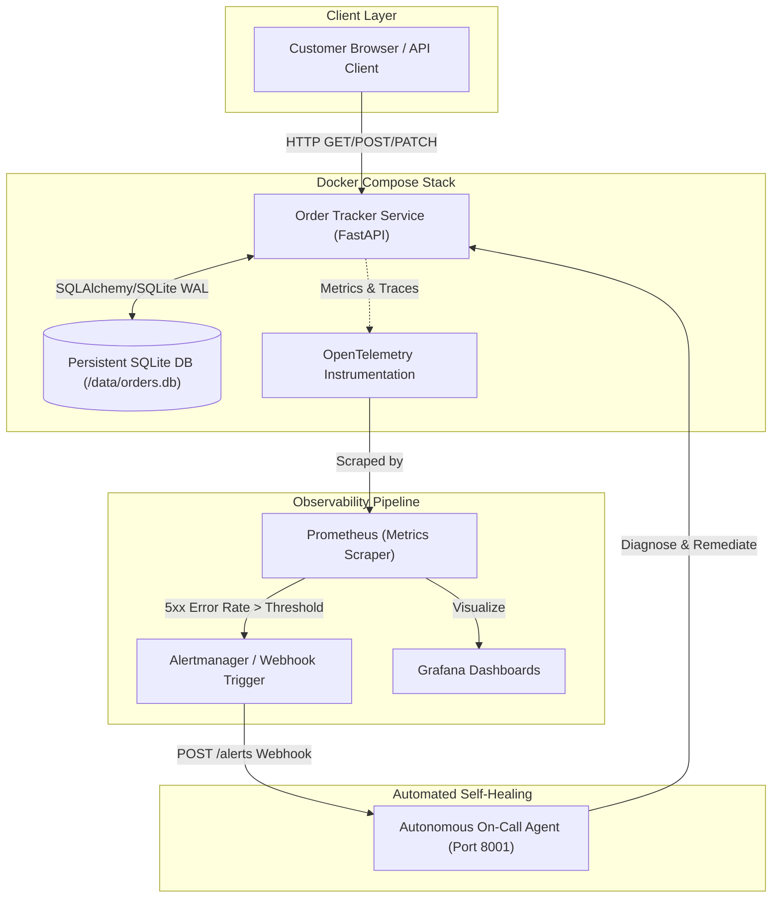

# System Architecture & Telemetry Topology

This document describes the high-level architecture, network flows, and telemetry pipelines of the Order Tracker application.

---

## 🏗️ Architectural Topology

---

## 💾 Data Persistence Seam
* **Engine:** SQLite with WAL mode.
* **Volume:** Named Docker volume `orders:/data`.
* **Health Check:** `GET /healthz` executes an active `SELECT 1` query to verify SQLite responsiveness before marking the container ready in Compose.

---

## 📡 Observability Architecture

### 1. Traces & Distributed Context
* Every incoming request receives a unique `X-Request-ID` and trace context.
* Traces correlate spans across database execution, business logic, and response formatting.

### 2. Metrics & Scraping
* Endpoint metrics tracked:
  - `http_requests_total{method, path, status}`
  - `http_request_duration_seconds{method, path}`
  - `orders_created_total{priority}`

### 3. Alert Routing
* **Rule:** `HighErrorRate5xx`
* **Condition:** Triggered when the 1-minute rate of 5xx responses exceeds 0.
* **Filter:** Excludes client 4xx errors (`GET /api/orders/missing` produces 404, preserving normal alert state).
* **Target:** Sends structured alert JSON to `http://localhost:8001/alerts`.
